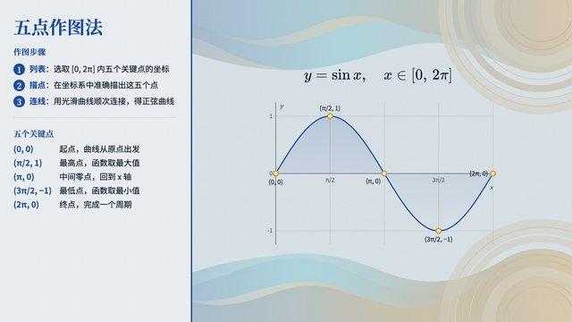
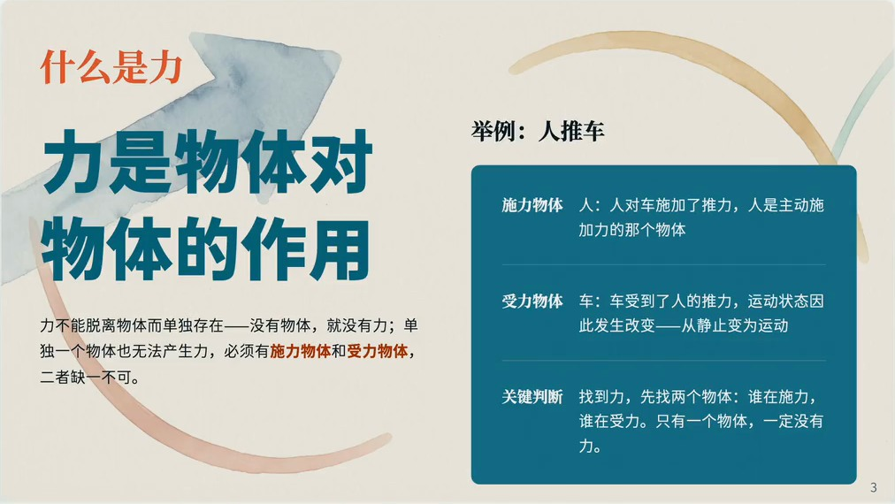
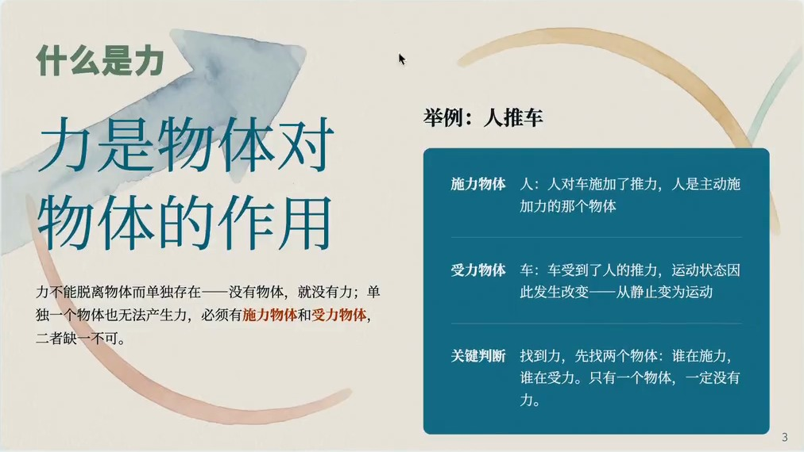
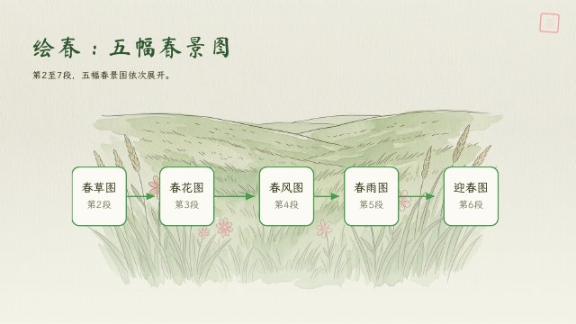
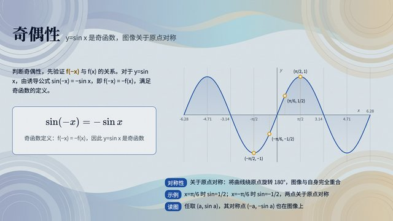
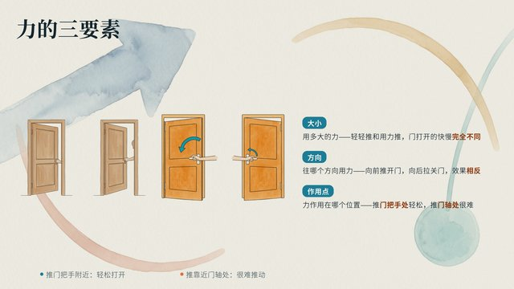

<h1 align="center">Polaris Dance</h1>

  

<strong>一句话做课件，再一句话改课件。</strong>

  面向教学的 PPT Agent，支持生成课件、对话改页和导出 PPTX / PDF。

  
  &nbsp; <a href="#课件示例">看课件示例</a>
  &nbsp; · &nbsp; <a href="#完整演示">看完整演示</a>

  

## 从主题生成 PPT

<table>
  <thead>
    <tr>
      <th width="50%">一句主题</th>
      <th width="50%">完整要求</th>
    </tr>
  </thead>
  <tbody>
    <tr>
      <td valign="top">「给初一学生讲朱自清的《春》」</td>
      <td valign="top">「给高一学生讲一节课：正弦函数 y=sin x 的图像与性质。……」</td>
    </tr>
    <tr>
      <td valign="top">
        
        
<a href="result/1-春.pdf">看《春》的完整 PDF</a>

      </td>
      <td valign="top">
        
        
<a href="result/2-数学.pdf">看正弦函数的完整 PDF</a>

        

          
展开原始提示词

          <blockquote>给高一学生讲一节课：正弦函数 y=sin x 的图像与性质。要讲清楚五点作图法、周期性、奇偶性、单调区间和最值，配合图像来讲</blockquote>
        

      </td>
    </tr>
  </tbody>
</table>

## 一句话修改指定页

《力学第一课》生成后，用户在对话中指定修改第 3 页。

> 把标题的字体颜色改成浅绿色，并且改一下标题和内容的字体，改现在有的字体即可。

| 修改前 | 修改后 |
| :---: | :---: |
|  |  |

[完整演示](#完整演示)从 2:03 开始展示对话修改。

## 课件示例

四份课件由 Polaris Dance 生成。每份 8 页，点击图片可以放大查看。

<table>
  <tr>
    <td align="center" width="50%">
       
      <strong>语文 · 朱自清《春》</strong> 
      盼春、绘春、赞春梳理全文结构 
      <a href="result/1-春.pdf">看完整 PDF</a> · <a href="compare/README.md#朱自清春">逐页对比</a>
    </td>
    <td align="center" width="50%">
       
      <strong>数学 · 正弦函数</strong> 
      用公式和曲线讲解奇偶性 
      <a href="result/2-数学.pdf">看完整 PDF</a> · <a href="compare/README.md#正弦函数">逐页对比</a>
    </td>
  </tr>
  <tr>
    <td align="center" width="50%">
       
      <strong>物理 · 力学第一课</strong> 
      用三扇门讲解力的三要素 
      <a href="result/3-物理.pdf">看完整 PDF</a> · <a href="compare/README.md#力学第一课">逐页对比</a>
    </td>
    <td align="center" width="50%">
       
      <strong>后端 · Redis 缓存故障</strong> 
      热点 Key 过期引发缓存击穿的流程 
      <a href="result/4-redis.pdf">看完整 PDF</a> · <a href="compare/README.md#redis-缓存故障">逐页对比</a>
    </td>
  </tr>
</table>

[查看 Polaris Dance、豆包和 Claude Opus 5.5 的同题对比、完整提示词和模型设置 →](compare/README.md)

## 在线体验

1. 打开 [polarisdance.online](https://polarisdance.online/)，输入「给初一学生讲力学第一课」，选择页数和比例。
2. 确认大纲后开始生成。页面会陆续出现，8 页通常需要约 15–25 分钟。
3. 在对话框里修改页面，例如「所有页加上页码」。可以说「撤销」来撤回上一次修改。
4. 在页面右下角导出 PPTX 或 PDF。

中国大陆访问可能较慢，也可以先浏览上面的课件示例。

## 完整演示

《力学第一课》的生成、断点续做和对话修改过程。视频为 3 倍速，约 3 分钟。

https://github.com/user-attachments/assets/b6f2a6b3-5b67-4841-a0b2-c14a612d7c92

[查看仓库中的视频文件](demo/demo.mp4)

查看演示时间线

| 时间 | 操作 |
| --- | --- |
| 0:00 | 输入「给初一学生讲力学第一课」，选择 8 页、16:9，确认生成的大纲 |
| 0:49 | 网络中断后，点击「接着做完」 |
| 1:40 | 查看生成的 8 页课件，实际用时约 19 分钟 |
| 2:03 | 对话要求全篇加页码，修改第 3 页标题和第 7 页底图。Agent 询问第 7 页需要哪种黄色 |
| 2:33 | 明确第 7 页使用明亮暖黄色，并调整第 3 页标题颜色和字体 |

## 微信交流群

本项目仍在迭代中，欢迎加入交流群提意见，欢迎有想法的朋友们一起合作

  

---

本仓库用于展示 Polaris Dance 的课件成果和同题对比。应用请通过[在线演示](https://polarisdance.online/)体验。
