# 同题课件对比

[返回 Polaris Dance 首页](../README.md) · [在线体验](https://polarisdance.online/)

四个主题分别交给 Polaris Dance、豆包在线 PPT 和 Claude Opus 5.5 直出（推理程度 high）。每份为 8 页。各工具独立组织内容，按页码排列便于浏览。

这里展示的是这四组样例。Redis 的 Polaris Dance 版本在生成后还通过对话修改了部分页面和背景。

[朱自清《春》](#朱自清春) · [正弦函数](#正弦函数) · [力学第一课](#力学第一课) · [Redis 缓存故障](#redis-缓存故障)

## 朱自清《春》

**提示词**

> 给初一学生讲朱自清的《春》

[Polaris Dance PDF](../result/1-春.pdf) · [豆包 PDF](1-春-豆包.pdf) · [Claude Opus 5.5 PDF](1-春-opus5.5.pdf)

展开 8 页对比

| 页 | Polaris Dance | 豆包 | Claude Opus 5.5 |
| :--: | :--: | :--: | :--: |
| 1 |  |  | <a href="../preview/1-spring/opus-1.jpg">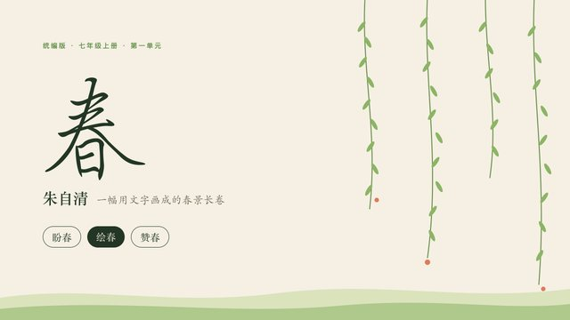</a> |
| 2 | <a href="../preview/1-spring/ours-2.jpg">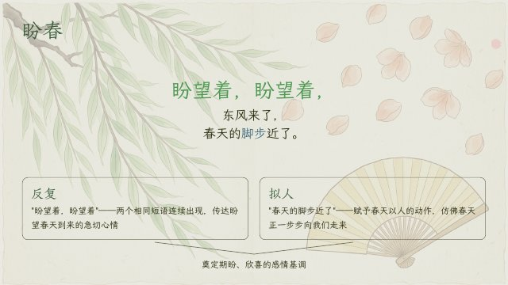</a> |  | <a href="../preview/1-spring/opus-2.jpg">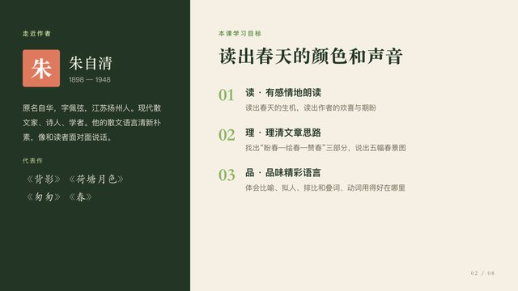</a> |
| 3 | <a href="../preview/1-spring/ours-3.jpg">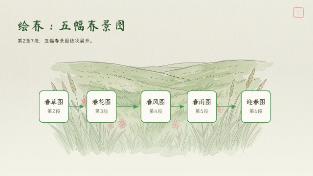</a> |  | <a href="../preview/1-spring/opus-3.jpg">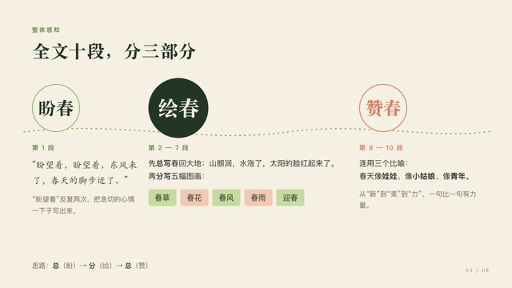</a> |
| 4 |  | <a href="../preview/1-spring/doubao-4.jpg">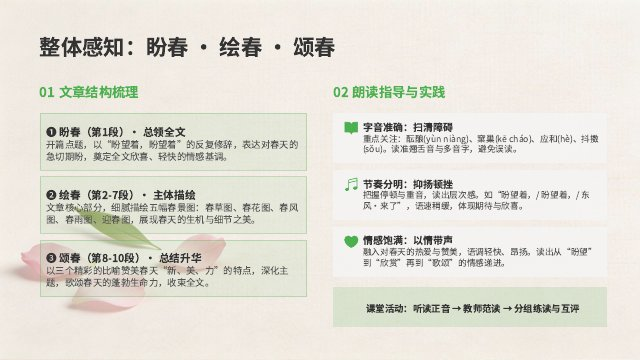</a> | <a href="../preview/1-spring/opus-4.jpg">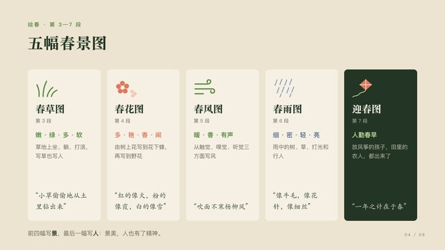</a> |
| 5 | <a href="../preview/1-spring/ours-5.jpg">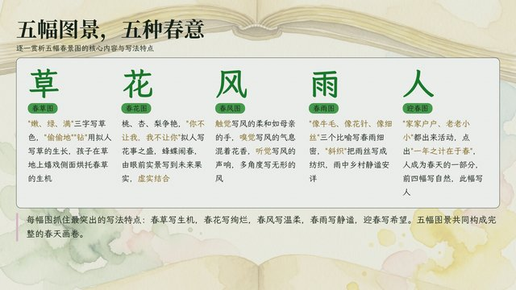</a> |  | <a href="../preview/1-spring/opus-5.jpg">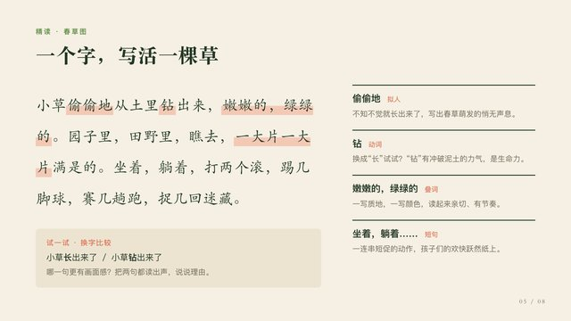</a> |
| 6 | <a href="../preview/1-spring/ours-6.jpg">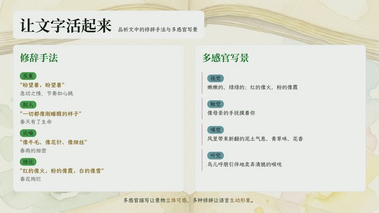</a> |  |  |
| 7 |  |  |  |
| 8 |  |  | <a href="../preview/1-spring/opus-8.jpg">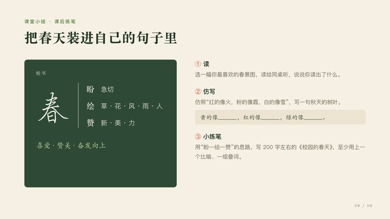</a> |

## 正弦函数

**提示词**

> 给高一学生讲一节课：正弦函数 y=sin x 的图像与性质。要讲清楚五点作图法、周期性、奇偶性、单调区间和最值，配合图像来讲

[Polaris Dance PDF](../result/2-数学.pdf) · [豆包 PDF](2-数学-豆包.pdf) · [Claude Opus 5.5 PDF](2-数学-opus5.5.pdf)

展开 8 页对比

| 页 | Polaris Dance | 豆包 | Claude Opus 5.5 |
| :--: | :--: | :--: | :--: |
| 1 |  |  | <a href="../preview/2-sine/opus-1.jpg">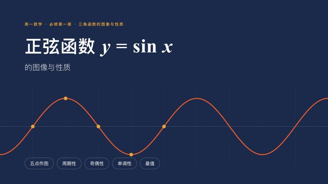</a> |
| 2 | <a href="../preview/2-sine/ours-2.jpg">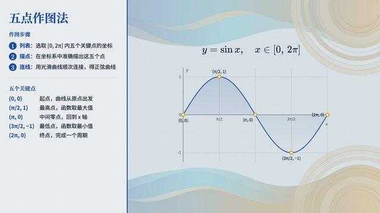</a> |  | <a href="../preview/2-sine/opus-2.jpg">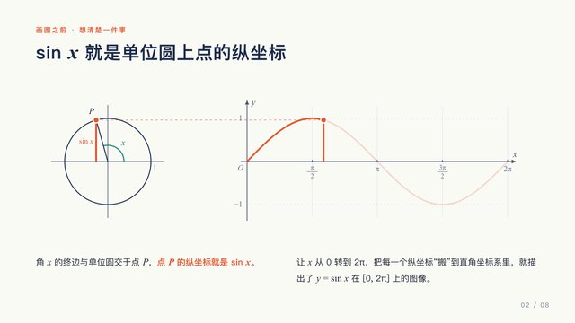</a> |
| 3 | <a href="../preview/2-sine/ours-3.jpg">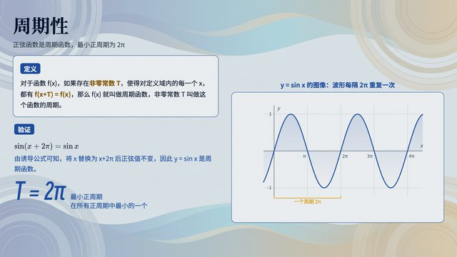</a> | <a href="../preview/2-sine/doubao-3.jpg">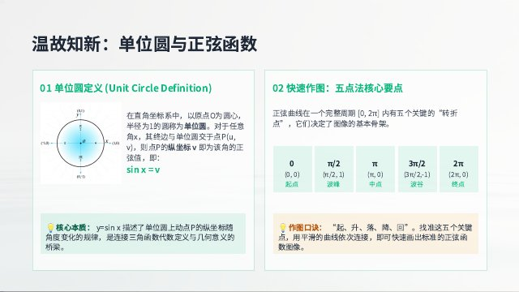</a> | <a href="../preview/2-sine/opus-3.jpg">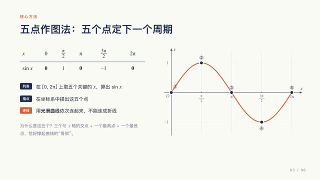</a> |
| 4 | <a href="../preview/2-sine/ours-4.jpg">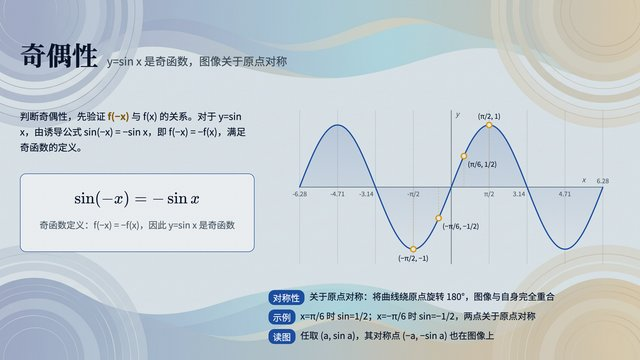</a> | <a href="../preview/2-sine/doubao-4.jpg">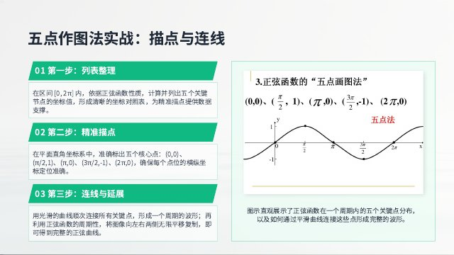</a> | <a href="../preview/2-sine/opus-4.jpg">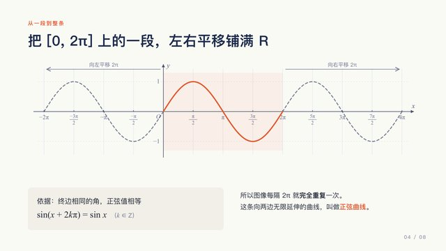</a> |
| 5 | <a href="../preview/2-sine/ours-5.jpg">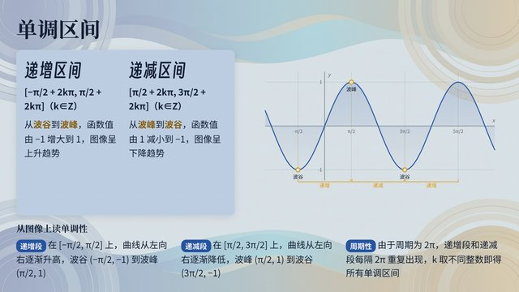</a> | <a href="../preview/2-sine/doubao-5.jpg">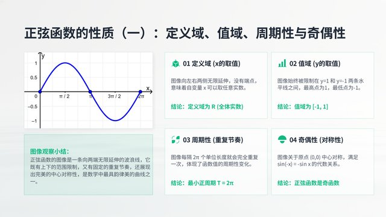</a> | <a href="../preview/2-sine/opus-5.jpg">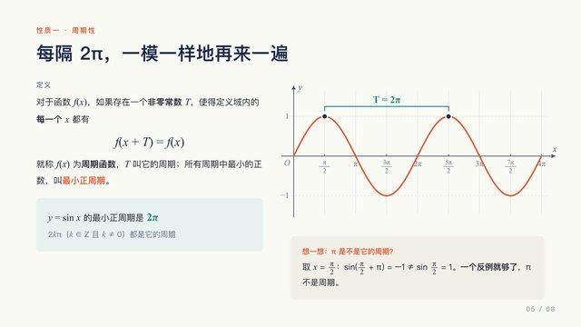</a> |
| 6 | <a href="../preview/2-sine/ours-6.jpg">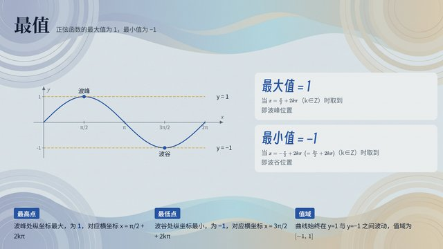</a> |  | <a href="../preview/2-sine/opus-6.jpg">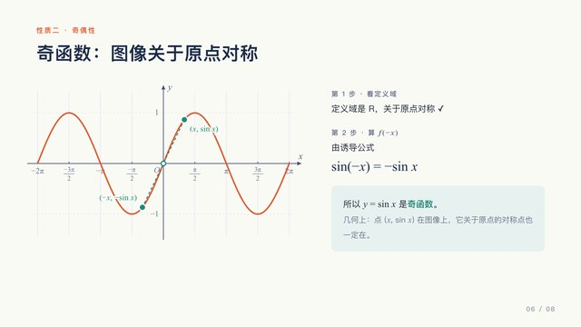</a> |
| 7 | <a href="../preview/2-sine/ours-7.jpg">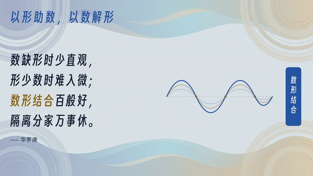</a> | <a href="../preview/2-sine/doubao-7.jpg">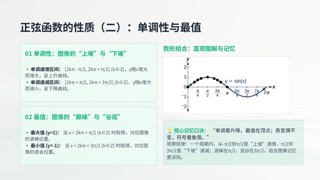</a> | <a href="../preview/2-sine/opus-7.jpg">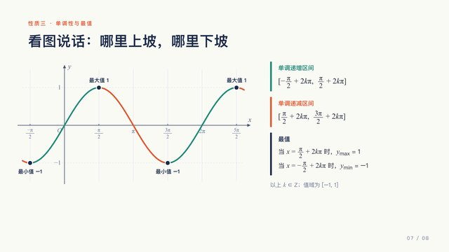</a> |
| 8 | <a href="../preview/2-sine/ours-8.jpg">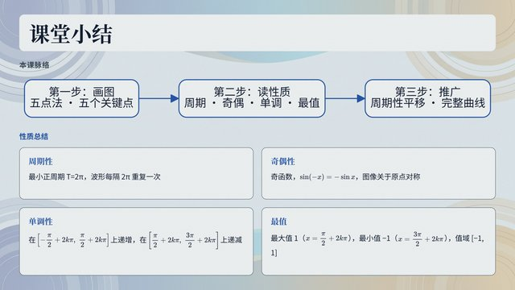</a> |  | <a href="../preview/2-sine/opus-8.jpg">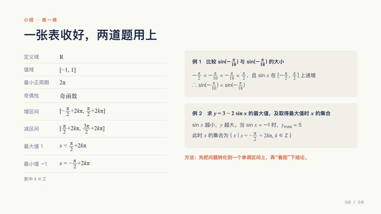</a> |

## 力学第一课

**提示词**

> 给初一学生讲力学第一课

[Polaris Dance PDF](../result/3-物理.pdf) · [豆包 PDF](3-物理-豆包.pdf) · [Claude Opus 5.5 PDF](3-物理-opus5.5.pdf)

展开 8 页对比

| 页 | Polaris Dance | 豆包 | Claude Opus 5.5 |
| :--: | :--: | :--: | :--: |
| 1 | <a href="../preview/3-force/ours-1.jpg">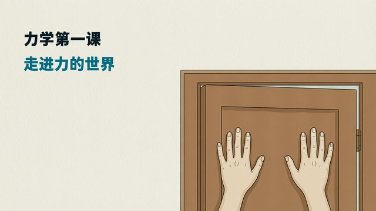</a> |  | <a href="../preview/3-force/opus-1.jpg">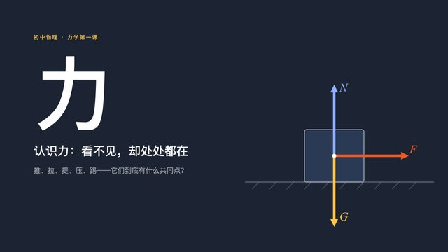</a> |
| 2 |  |  |  |
| 3 | <a href="../preview/3-force/ours-3.jpg">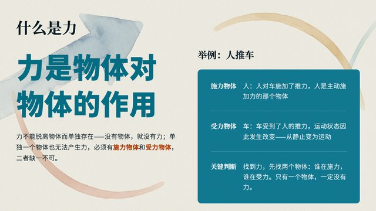</a> |  | <a href="../preview/3-force/opus-3.jpg">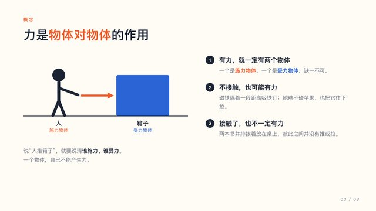</a> |
| 4 | <a href="../preview/3-force/ours-4.jpg">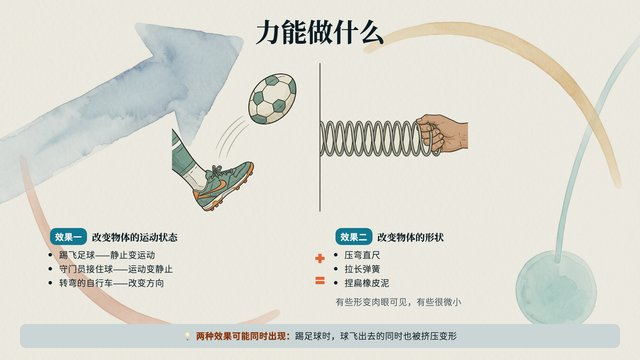</a> |  | <a href="../preview/3-force/opus-4.jpg">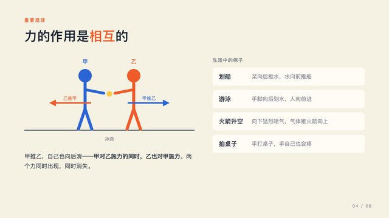</a> |
| 5 | <a href="../preview/3-force/ours-5.jpg">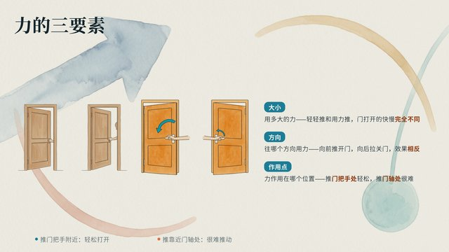</a> |  | <a href="../preview/3-force/opus-5.jpg">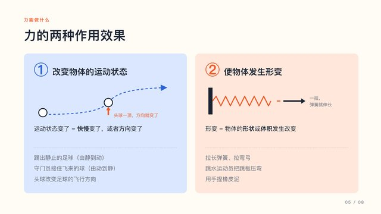</a> |
| 6 |  | <a href="../preview/3-force/doubao-6.jpg">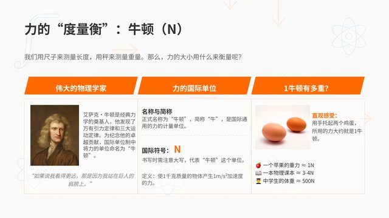</a> | <a href="../preview/3-force/opus-6.jpg">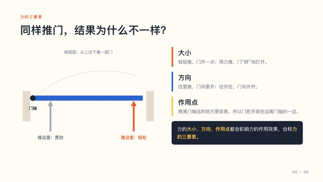</a> |
| 7 |  |  | <a href="../preview/3-force/opus-7.jpg">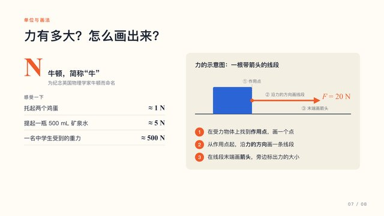</a> |
| 8 | <a href="../preview/3-force/ours-8.jpg">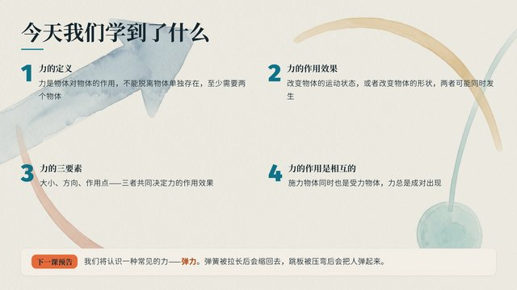</a> |  |  |

## Redis 缓存故障

**提示词**

> 给后端工程师讲清楚 Redis 的缓存穿透、缓存击穿和缓存雪崩

[Polaris Dance PDF](../result/4-redis.pdf) · [豆包 PDF](4-redis-豆包.pdf) · [Claude Opus 5.5 PDF](4-redis-opus5.5.pdf)

展开 8 页对比

| 页 | Polaris Dance | 豆包 | Claude Opus 5.5 |
| :--: | :--: | :--: | :--: |
| 1 | <a href="../preview/4-redis/ours-1.jpg">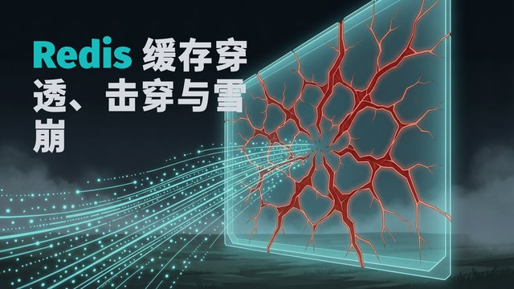</a> |  | <a href="../preview/4-redis/opus-1.jpg">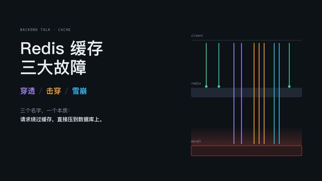</a> |
| 2 | <a href="../preview/4-redis/ours-2.jpg">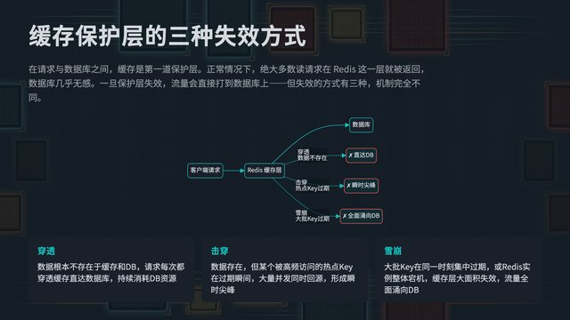</a> |  | <a href="../preview/4-redis/opus-2.jpg">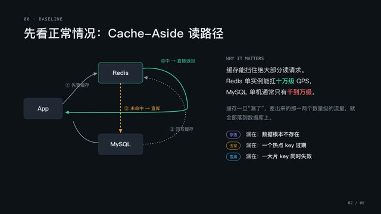</a> |
| 3 | <a href="../preview/4-redis/ours-3.jpg">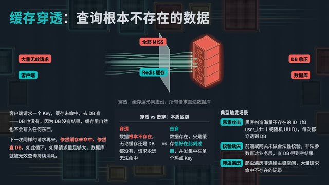</a> |  | <a href="../preview/4-redis/opus-3.jpg">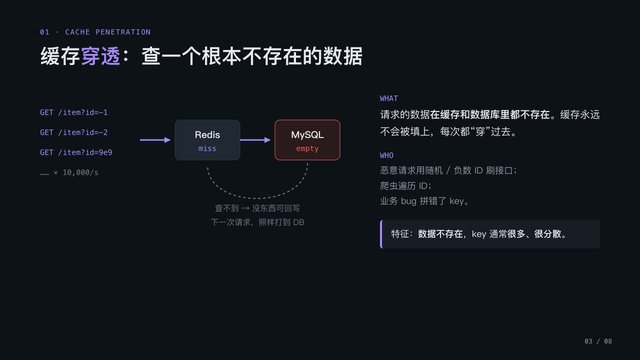</a> |
| 4 | <a href="../preview/4-redis/ours-4.jpg">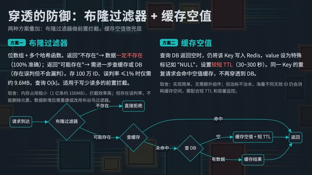</a> |  | <a href="../preview/4-redis/opus-4.jpg">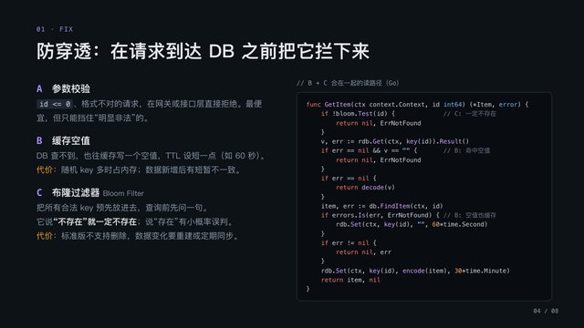</a> |
| 5 |  |  |  |
| 6 |  |  |  |
| 7 |  |  |  |
| 8 |  |  |  |

## Polaris Dance 使用模型

| 环节 | 模型 |
| --- | --- |
| 理解需求、大纲、文稿、设计 | **Qwen3.7-Plus**（推理程度 low） |
| 配图、底图 | **Wan2.7-Image-Pro** / Wan2.7-Image |
| 意图识别 （听懂改哪几页、改什么） | **Qwen3.8-Flash** |

PDF 预览加载较慢时，可以从 GitHub 的文件页面下载查看。
